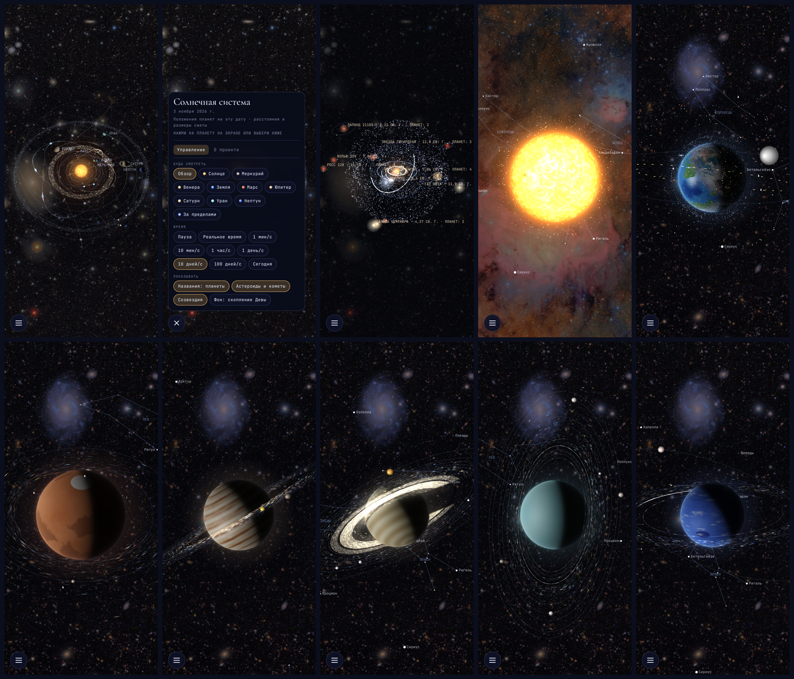

# Stars — Солнечная система

Интерактивная модель Солнечной системы для телефона и браузера: планеты на своих настоящих местах на текущую дату, крупные планы с вращающимися планетами и кольцами из частиц, спутники, станции, астероиды, кометы, метеорные потоки, зонды и вид «за пределами» с гелиосферой, облаком Оорта и ближайшими звёздами. Есть Android-приложение, которое работает без интернета.

- Живая версия: https://claude.ai/artifact/AdCL3VEKMepQXaYjbTw8Hq (приватная ссылка владельца)
- Репозиторий: https://github.com/6299833-byte/Stars
- Сборки APK: https://github.com/6299833-byte/Stars/actions (артефакт `app-debug` у каждой зелёной сборки)

---

## Что в архиве

| Папка или файл | Что это |
|---|---|
| `solar-system.html` | **Основное приложение.** Один файл: HTML, CSS, JavaScript, шейдеры WebGL. Сборки не требует |
| `img/` | Фотографии: фоны обсерватории Рубин и снимки Земли NASA |
| `index.html` | Первая версия: планета с кольцами из частиц по образцу видео, можно добавлять планеты, луны, вспышки и кометы касанием |
| `milky-way.html` | Модель Млечного Пути из ~100 тысяч частиц (WebGL) |
| `www/` | **Рабочая версия для запуска без интернета:** страница, шрифты и снимки, собранные скриптом `scripts/build-www.mjs`. Открой `www/index.html` |
| `android/project/` | Android-проект (Capacitor 8.5.3) |
| `android/PLAN.md` | План Android-приложения от агента-архитектора |
| `docs/maket.png` | Макет: 10 экранов текущей версии при ширине телефона |
| `android/store/` | Материалы для Google Play: описание, скриншоты, иконка, политика конфиденциальности, ответы на анкеты, лицензии, инструкция по подписи |
| `scripts/build-www.mjs` | Скрипт сборки `www/` |
| `package.json`, `capacitor.config.json` | Настройки сборки Android |
| `.github/workflows/android.yml` | Автосборка APK в GitHub Actions |
| `desktop/` | Живые обои для Windows: помощник `stars_helper.py`, настройки, инструкция |
| `.claude/agents/` | Описания агентов: отдел графики, астроном, отдел Android, поиск ошибок |

---

## Макет



Верхний ряд: общий вид, меню, «За пределами», Солнце, Земля. Нижний ряд: Марс, Юпитер, Сатурн, Уран, Нептун.

## Как запустить

**В браузере.** Открой `www/index.html` или `solar-system.html` в Chrome, Safari или Firefox. Нужен WebGL. Если открыть файл с диска, снимки Земли не встроятся в глобус (браузер запрещает обрабатывать картинки из `file://`) и Земля будет нарисованной. Чтобы были настоящие материки, запусти локальный сервер:

```sh
cd www && python3 -m http.server 8000
# открыть http://localhost:8000
```

**Android.** Скачай `app-debug` из последней зелёной сборки на https://github.com/6299833-byte/Stars/actions, распакуй zip, установи `app-debug.apk` на телефон и разреши установку из этого источника. Приложение не просит никаких разрешений и работает без интернета.

**Собрать APK самому** (нужны Node 22, JDK 21 и Android SDK с платформой 36):

```sh
npm ci
npm run build                 # собирает www/
npx cap sync android
cd android/project && ./gradlew assembleDebug
# APK: android/project/app/build/outputs/apk/debug/app-debug.apk
```

---

## Живые обои для Windows

Папка `desktop/`: Солнечная система как живые обои рабочего стола (Lively Wallpaper или Wallpaper Engine). Справа часы, встречи из календаря Outlook и новые сообщения Outlook и WhatsApp Web. Помощник `stars_helper` читает календарь по ссылке ICS и уведомления Windows и работает только на компьютере. Режим обоев включается адресом `…#wallpaper`: меню скрыто, камера сама облетает планеты, около 30 кадров в секунду. Готовый `stars_helper.exe` собирает GitHub Actions (сборка «Windows wallpaper», артефакт `stars-wallpaper-windows`). Пошаговая установка в [desktop/README.md](desktop/README.md).

## Управление

Всё управление собрано в круглой кнопке ☰ в левом нижнем углу. Когда меню закрыто, на экране только эта кнопка.

- **Куда смотреть:** обзор, Солнце, восемь планет, «За пределами».
- **Время:** пауза, реальное время, 1 мин/с, 10 мин/с, 1 час/с, 1 день/с, 10 дней/с, 100 дней/с, «Сегодня». У каждой планеты включается своя скорость: у Земли и Марса минута в секунду, у гигантов 10 минут, у Солнца, Меркурия и Венеры час.
- **Показывать:** названия (скрыть, планеты, все), астероиды и кометы, созвездия, фон (скопление Девы, Лагуна и Трёхраздельная, Rubin’s Cosmos).
- **За пределами:** нажми на соседнюю звезду, чтобы подлететь к её планетной системе.
- **Вкладка «О проекте»:** авторы снимков, лицензии, пояснения о точности.
- **Жесты:** нажать на планету или тело — подлететь к нему; провести пальцем — повернуть; щипок или колесо мыши — масштаб.
- **Кнопка «Назад» на Android:** закрывает меню, потом выходит из крупного плана, потом закрывает приложение.

---

## Что сделано

### 1. Планета из частиц по образцу видео (`index.html`)
Синяя планета с наклонными кольцами из ~10 тысяч частиц, кеплеровы скорости (внутренние частицы быстрее), разлетающаяся пыль, мерцающие звёзды. Касанием добавляются планеты, луны, вспышки и кометы.

### 2. Млечный Путь (`milky-way.html`)
Около 100 тысяч частиц на WebGL: перемычка длиной ~27 000 св. лет, рукава Щита — Центавра и Персея, слабые рукава Наугольника и Стрельца, 3-килопарсековые рукава, пылевые полосы, области звездообразования, Солнце в рукаве Ориона, вид сверху, под углом и с ребра. Структура сверена с описаниями иллюстрации NASA/JPL-Caltech (R. Hurt).

### 3. Солнечная система (`solar-system.html`) — основная работа

**Общий вид**
- Планеты по эллиптическим орбитам (средние долготы J2000 и уравнение центра) на сегодняшнюю дату. Шкала расстояний сжата логарифмически.
- Пояс астероидов с люками Кирквуда, троянцы Юпитера в точках L4 и L5, пояс Койпера со скоплением плутино. Всё это — частицы на видеокарте со штрихами движения.
- Светящиеся следы орбит, свечение (bloom), солнечная корона.
- Карликовые планеты Церера, Плутон, Эрида, Макемаке, Хаумеа.
- Астероиды Веста, Паллада, Гигея, Психея, Эрос, Бенну, Рюгу, Фаэтон и Апофис. Апофис настроен на сближение с Землёй 13 апреля 2029 года.
- Кометы Галлея, Энке, Чурюмова — Герасименко, Свифта — Таттла, Темпеля — Таттла. У Солнца у них растут хвосты, направленные от Солнца.
- Межзвёздные объекты Оумуамуа, комета Борисова и 3I/ATLAS на гиперболических траекториях.
- Метеорные потоки: Персеиды, Леониды, Геминиды, Ориониды, эта-Аквариды, Тауриды. Метки с датой стоят там, где их пересекает Земля.
- Зонды: Parker Solar Probe, Solar Orbiter, «Вояджер-1» и «Вояджер-2», «Новые горизонты».

**Крупные планы**
- Планеты рисуются по каждому пикселю шейдером WebGL: мягкая граница дня и ночи, атмосфера, блик на океанах, облака, огни городов, затемнение к краю, глянцевый ободок.
- Каждое тело вращается с настоящим звёздным периодом и наклоном оси, а ось направлена по полюсам МАС (IAU 2015). Земля повёрнута по настоящему звёздному времени.
- **Земля** собрана из трёх снимков целого диска: «Голубой шарик» с «Аполлона-17» и два композита Blue Marble 2002 года. Камера каждого снимка подобрана по известным местам (Мадагаскар, Австралия, Флорида, Гренландия, Гибралтар). Тихий океан нарисован.
- **Кольца** — десятки тысяч частиц на видеокарте со штрихами движения поверх сплошного кольца с настоящим профилем. У Сатурна видны кольца D, C, B, A и F, щель Кассини, щели Энке и Килера. Тень планеты лежит на кольцах, тень колец на планете. Кольца Урана на измеренных радиусах, дуги в кольце Адамса у Нептуна.
- На небе за планетами — созвездия по настоящим координатам звёзд (Большая и Малая Медведица, Орион, Кассиопея, Лебедь, Лира, Орёл, Скорпион, Южный Крест, Лев, Близнецы, Телец, Пегас) и яркие звёзды с подписями. Переключатель «Созвездия» в меню.
- Шестиугольник на северном полюсе Сатурна, Большое Красное Пятно, тёмное пятно Нептуна, грануляция Солнца, протуберанцы и корона.
- **Спутники:** Луна (на настоящем месте, с правильной фазой), Фобос и Деймос, галилеевы спутники, шесть крупных спутников Сатурна, пять спутников Урана, Протей и Тритон (обратное движение). Каждый со своим периодом.
- **Около Земли:** МКС, Тяньгун, Хаббл, Чандра, Landsat 9, GOES-19, «Электро-Л», Meteosat-12, «Молния» на вытянутой орбите с апогеем над севером, Iridium, тысячи спутников Starlink, OneWeb, GPS, ГЛОНАСС, Galileo, BeiDou, геостационарное кольцо, «Уэбб» в точке L2. Спутники гаснут в тени Земли.
- **Около Марса:** MRO, Mars Odyssey, TGO, MAVEN, Mars Express, «Тяньвэнь-1», «Аль-Амаль».

**За пределами Солнечной системы**
- Гелиосфера с хвостом, направленным против межзвёздного ветра, ударная волна внутри неё и лента IBEX.
- Облако Оорта: сплюснутое внутреннее облако Хиллса и внешняя сфера.
- Соседние звёздные системы в настоящих направлениях, с известными планетами на своих периодах: Альфа Центавра (A, B, Проксима b и d), звезда Барнарда (4 планеты), Вольф 359, Лаланд 21185, Сириус A и B, Эпсилон Эридана (планета и два пылевых пояса), Росс 128, Тау Кита (кандидаты), звезда Лейтена, звезда Тигардена, TRAPPIST-1 (7 планет). Нажатие на звезду открывает её систему и карточку. Кандидаты в планеты показаны пунктиром.

**Фоны.** Снимки обсерватории Рубин: скопление галактик Девы, туманности Лагуна и Трёхраздельная, Rubin’s Cosmos. Цветные следы спутников на снимке спиральной галактики отфильтрованы.

### 4. Android-приложение
- Capacitor 8.5.3, `io.github.stars.solarsystem`, minSdk 24, targetSdk 36.
- Работает полностью без интернета: шрифты и снимки внутри, разрешения INTERNET нет.
- Полноэкранный режим, экран под вырезом камеры, экран не гаснет, обе ориентации, кнопка «Назад» через мост `window.solarBack`.
- Автосборка APK в GitHub Actions. Если добавить ключ подписи в секреты репозитория, собирается и подписанный AAB для Google Play.
- Иконка, скриншоты и материалы для Google Play в `android/store/`. Работа над Android сейчас **приостановлена**, а приложение в магазине не публикуется.

### 5. Агенты (`.claude/agents/`)
- **Отдел графики:** graphics-director, vfx-artist, lighting-artist, graphics-engineer.
- **Консультант:** astronomer.
- **Поиск ошибок:** bug-hunter.
- **Отдел Android:** android-architect, android-engineer, android-qa, android-release.

Их проверки нашли и исправили, в частности:
- одинаковый наклон полюсов у всех планет (из-за него были перепутаны времена года);
- спутники и кольца, вращавшиеся в обратную сторону;
- кольца Урана, рисовавшиеся пунктиром;
- время, которое могло идти назад;
- непрозрачную тень на кольцах Сатурна.

---

## Точность и допущения

- Расстояния и размеры сжаты, шкала логарифмическая.
- Положения планет точны примерно до градуса. У Плутона, комет, межзвёздных объектов и Parker Solar Probe заданы даты перигелия. У остальных астероидов положение на орбите примерное.
- Спутники и станции летают по настоящим высотам, наклонам и периодам, но не в реальном времени: для этого нужны данные слежения из интернета.
- Положения «Вояджеров» и «Новых горизонтов» примерные.
- Поверхности планет, кроме Земли, процедурные, нарисованы шейдером.

---

## Авторы и лицензии

- **Фоны:** © NSF–DOE Vera C. Rubin Observatory/NOIRLab/SLAC/AURA, лицензия CC BY 4.0 (https://rubinobservatory.org/gallery/media-policy).
- **Земля:** «The Blue Marble», экипаж «Аполлона-17», 1972; композиты Blue Marble 2002 года (Центр Годдарда NASA, MODIS). NASA, общественное достояние.
- **Шрифты:** Cormorant Garamond и JetBrains Mono, SIL OFL 1.1.
- **Android:** Capacitor (MIT), AndroidX (Apache 2.0).
- Подробнее в `android/store/NOTICES.md`.
