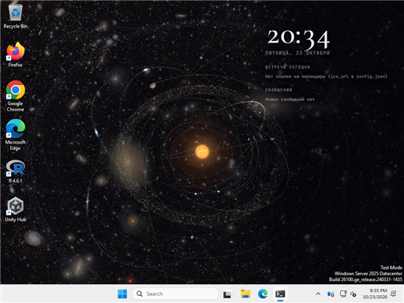

# Живые обои «Солнечная система» для Windows

Солнечная система на рабочем столе, за иконками. Справа часы, встречи из календаря Outlook и все новые уведомления Windows: WhatsApp Web, Outlook, Teams, Telegram и любые другие программы. Камера сама медленно облетает планеты.



Снимок сделан автоматической проверкой в GitHub Actions на Windows Server 2025 (сборка 26100, как Windows 11 24H2).

Есть два способа:

1. **StarsDesktop.exe** — наш собственный движок живых обоев. Ничего больше ставить не нужно. Рекомендуется.
2. **Lively Wallpaper или Wallpaper Engine + stars_helper.exe**, если ты уже пользуешься одной из этих программ.

```
Outlook в интернете ──(ссылка ICS)──┐
                                     ├─► StarsDesktop.exe ──► окно за иконками на каждом мониторе (WebView2)
Уведомления Windows ─(только чтение)┘
```

Всё работает только на твоём компьютере. Наружу программа ничего не отправляет, она только скачивает твою же ссылку на календарь.

---

## 1. Скачай

На странице https://github.com/6299833-byte/Stars/actions открой последнюю зелёную сборку **«Windows wallpaper»** и скачай артефакт **stars-wallpaper-windows**. Распакуй его в постоянную папку, например `C:\Stars`. В ней будут:

- `StarsDesktop.exe` — движок обоев;
- `stars_helper.exe` — помощник для Lively и Wallpaper Engine (для способа 1 он не нужен);
- `www\` — сами обои: страница, снимки, шрифты;
- `config.json` — настройки.

## 2. Запусти

Двойной щелчок по `StarsDesktop.exe`. Обои появятся за иконками на всех мониторах, а в трее (у часов) — значок планеты с кольцом. Меню значка (правая кнопка):

- **Пауза** — остановить обои (двойной щелчок по значку делает то же самое);
- **Обновить встречи и сообщения**;
- **Перезапустить обои** — если что-то пропало после смены мониторов;
- **Настройки (config.json)** — открывает файл в Блокноте; изменения применяются сразу после сохранения;
- **Папка с журналом** — `%LOCALAPPDATA%\StarsDesktop\log.txt`, пригодится, если что-то не работает;
- **Запускать вместе с Windows** — включено по умолчанию;
- **Выход** — возвращает обычный фон рабочего стола.

### Несколько экранов: свой фон на каждом

У каждого монитора свои настройки: значок в трее → **Экраны** → «Экран 1 — слева…», «Экран 2 — по центру…», «Экран 3 — справа…». Выбор применяется сразу и запоминается.

- **Фон:**
  - скопление галактик Девы;
  - туманности Лагуна и Трёхраздельная;
  - Rubin’s Cosmos (поле из тысяч далёких галактик);
  - Космические утёсы — снимок телескопа «Джеймс Уэбб», туманность Киля;
  - Крабовидная туманность — мозаика «Хаббла», остаток сверхновой 1054 года;
  - **Млечный Путь** — вместо Солнечной системы на экране вся наша Галактика, она медленно вращается и покачивается.
- **Вид:**
  - облёт планет (по умолчанию);
  - вся система;
  - одна планета или Солнце;
  - «За пределами» — соседние звёзды.
- **Часы, встречи и сообщения** — показывать ли панель на этом экране. По умолчанию она только на основном мониторе.

Сначала экраны получают разные фоны: первый — Деву, второй — Лагуну, третий — Rubin’s Cosmos. Выбранный фон виден и в общем виде, и за планетами вблизи. В `config.json` это список `monitors`, экраны в нём идут слева направо:

```json
"monitors": [
  { "scene": "milkyway" },
  { "scene": "cluster", "view": "tour", "panel": true },
  { "scene": "field", "view": "saturn", "panel": false }
]
```

`scene`: `cluster`, `nebula`, `field`, `cliffs`, `crab`, `milkyway`. `view`: `tour`, `overview`, `sun`, `mercury`, `venus`, `earth`, `mars`, `jupiter`, `saturn`, `uranus`, `neptune`, `far`.

### Качество и видеокарта

Обои рисует видеокарта через DirectX: WebView2 переводит WebGL в Direct3D 11 (ANGLE). StarsDesktop просит Windows использовать **дискретную видеокарту** (NVIDIA, AMD), а не встроенную. Какая видеокарта используется, видно в подсказке у пункта «Качество» и в `log.txt`.

Значок в трее → **Качество**:

- **Обычное** — 30 кадров/с, для ноутбука.
- **Плавное** — 60 кадров/с.
- **Максимальное** — 60 кадров/с, картинка считается в 1,5 раза крупнее и сглаживается, частиц в кольцах в 3 раза больше, пыли в 2 раза, текстуры планет 2K. Для мощной видеокарты и нескольких больших мониторов.

Обои сами встают на паузу, когда:

- на мониторе открыта игра или видео во весь экран (пауза только на этом мониторе);
- экран заблокирован или ты подключён по удалённому рабочему столу;
- ноутбук работает от батареи;
- запущена программа из списка `pause_apps`.

Нужен **Microsoft Edge WebView2 Runtime**. В Windows 10 и 11 он обычно уже есть. Если нет, программа скажет об этом. Скачать его можно здесь: https://go.microsoft.com/fwlink/p/?LinkId=2124703.

Windows SmartScreen может предупредить о неизвестной программе, потому что она не подписана. Нажми «Подробнее» → «Выполнить в любом случае».

## 3. Ссылка на календарь Outlook (ICS)

1. Открой Outlook в браузере: https://outlook.office.com (рабочий аккаунт) или https://outlook.live.com (личный).
2. Шестерёнка → **Календарь** → **Общие календари** → **Опубликовать календарь**.
3. Выбери календарь и уровень доступа **«Может просматривать все сведения»** (или «…только время, когда я занят», если не нужны названия), нажми **Опубликовать**.
4. Скопируй ссылку **ICS** и вставь в `config.json` в поле `"ics_url"`.

Если в рабочем аккаунте нет пункта «Опубликовать календарь», значит, компания его отключила. Тогда календарь можно подключить через Microsoft Graph, но для этого нужно согласие администратора. Напиши, если нужен этот вариант.

> Ссылка ICS даёт доступ к календарю любому, у кого она есть. Не публикуй её и не пересылай.

## 4. Уведомления

Обои показывают уведомления, которые **появляются в Windows**. Программа читает копию файла `%LOCALAPPDATA%\Microsoft\Windows\Notifications\wpndatabase.db` и никогда его не меняет. Значит, уведомления нужно включить в самих программах:

- **WhatsApp Web:** открой https://web.whatsapp.com в Edge или Chrome, нажми «Включить уведомления» и разреши их браузеру. Вкладку держи открытой (можно свернуть). В Windows: «Параметры» → «Система» → «Уведомления» → включи для Microsoft Edge или Google Chrome. На обоях такие сообщения подписаны «WhatsApp», а не именем браузера.
- **Outlook:** в новом Outlook или Outlook в браузере включи уведомления о новых письмах (Настройки → Общие → Уведомления). Классический Outlook показывает их сам («Оповещение на рабочем столе»).
- **Остальные программы** (Teams, Telegram, Slack, Discord, Viber и т. д.) появятся сами, если у них включены уведомления Windows.
- Режим **«Не беспокоить»** не мешает: уведомления всё равно записываются.

Какие программы показывать, настраивается в `config.json`:

```json
"apps_only": ["whatsapp", "outlook"],   // показывать только эти; пустой список [] — все программы
"apps_hide": ["windows", "chrome"]      // никогда не показывать эти
```

Имена программ: `whatsapp`, `outlook`, `teams`, `telegram`, `gmail`, `slack`, `discord`, `viber`, `skype`, `zoom`, `calendar`, `chrome`, `edge`, `firefox`, `windows` (системные сообщения Windows). У других программ имя такое же, как подпись рядом с отправителем на обоях. У каждой программы своя цветная точка.

## Настройки `config.json`

| Поле | По умолчанию | Что делает |
|---|---|---|
| `ics_url` | `""` | ссылка ICS на календарь Outlook |
| `show_text` | `true` | `false` — показывать только отправителя, без текста сообщения |
| `apps_only` | `[]` | показывать только эти программы; пусто — все |
| `apps_hide` | `["windows"]` | никогда не показывать эти программы |
| `max_notifications` | `12` | сколько сообщений хранить в ленте |
| `notification_hours` | `12` | за сколько часов показывать сообщения |
| `days_ahead` | `7` | на сколько дней вперёд брать встречи |
| `fps` | `30` | кадров в секунду (60 — плавнее, 20 — легче для ноутбука) |
| `quality` | `"normal"` | `"ultra"` — максимальное качество для мощной видеокарты (см. «Качество и видеокарта») |
| `pause_fullscreen` | `true` | пауза, когда на мониторе приложение во весь экран |
| `pause_maximised` | `false` | пауза, даже когда окно просто развёрнуто |
| `pause_battery` | `true` | пауза при работе от батареи |
| `pause_remote` | `true` | пауза в удалённом сеансе |
| `pause_apps` | `[]` | пауза, пока запущена одна из программ, например `["obs64.exe"]` |
| `ufo` | `true` | иногда пролетает НЛО (шар, «тик-так», чёрный треугольник, тарелка, куб в сфере, «гимбал») |
| `meteors` | `true` | падающие метеоры над ночной стороной Земли и метеоры на небе |
| `show_panel` | `true` | `false` — только космос, без часов и ленты |
| `autostart` | `true` | запускать вместе с Windows |
| `monitors` | `[]` | фон, вид и панель для каждого экрана слева направо (см. «Несколько экранов»); заполняется сам |
| `port` | `8777` | порт `stars_helper` (только для Lively) |

StarsDesktop применяет изменения сразу после сохранения файла. Помощнику `stars_helper` нужен перезапуск.

---

## Способ 2: Lively Wallpaper или Wallpaper Engine + помощник

1. Запусти `stars_helper.exe` (окна не будет, он работает в фоне). Проверка: открой в браузере http://127.0.0.1:8777/#wallpaper, справа должны быть часы, встречи и сообщения. Для автозапуска нажми Win+R, введи `shell:startup` и положи в открывшуюся папку ярлык на `stars_helper.exe`.
2. **Lively Wallpaper** (Microsoft Store, бесплатно): **«+»** → в поле «Введите URL» вставь `http://127.0.0.1:8777/#wallpaper` → **«Установить как обои»**.
3. **Wallpaper Engine** (Steam): «Создать обои» → «Веб» → тот же адрес.
4. **Разные экраны:** в Lively для каждого монитора можно задать свой адрес. Например: `http://127.0.0.1:8777/#wallpaper&sky=nebula&view=saturn&panel=0` или `http://127.0.0.1:8777/milky-way.html#wallpaper` (Млечный Путь).

Помощник слушает только адрес `127.0.0.1`. Можно запускать и без `.exe`: установи Python 3 и запусти `start.bat` из папки `desktop`.

## Если что-то не работает

- **Обоев не видно, иконки на месте:** открой меню значка → «Перезапустить обои». Если не помогло, пришли `log.txt` из «Папки с журналом». В нём видно, какое окно рабочего стола нашла программа.
- **Обои стоят на месте:** проверь, не на паузе ли они (подсказка у значка в трее). Частая причина — работа от батареи.
- **Нет встреч:** проверь `ics_url`: открой ссылку в браузере, должен скачаться файл `.ics`. Календарь обновляется раз в 10 минут или по пункту «Обновить».
- **Нет сообщений WhatsApp:** уведомления WhatsApp Web выключены в браузере или в Windows, либо вкладка закрыта.
- **Видно лишнее:** обои видят все, кто подходит к компьютеру. Поставь `"show_text": false` или ограничь `apps_only`.
- **Не поддерживается:** файл уведомлений — внутренняя часть Windows 10 и 11. Microsoft может изменить его в обновлении. Если сообщения пропадут после обновления Windows, напиши.

## Как устроен движок

Исходники в `desktop/engine` (C#, .NET 8, WinForms + WebView2). Разведка и архитектура лежат в `replica/`: как работают Lively Wallpaper и Wallpaper Engine (только по открытым описаниям, без их кода) и что из этого мы сделали.

- `DesktopLayer.cs` — находит окно за иконками. Для этого программа посылает рабочему столу (Progman) сообщение 0x052C, и Explorer создаёт окно WorkerW. В Windows 11 24H2 оно лежит внутри Progman, в более ранних версиях — отдельным окном.
- `WallpaperWindow.cs` — окно на каждый монитор, дочернее к найденному слою. Внутри WebView2 открывает `https://stars.local/index.html#wallpaper` из папки `www` без интернета.
- `PauseRules.cs` — полноэкранные окна, блокировка, удалённый сеанс, батарея, список программ.
- `Feed.cs` — уведомления (все программы, имена и фильтры) и встречи (Ical.Net: повторы, исключения, часовые пояса).
- `Program.cs` — значок в трее, таймеры, автозапуск, перезапуск после падения Explorer, новые настройки без перезапуска.

Страница получает данные сообщениями `{"type":"feed", …}`, `{"type":"pause","on":true}` и `{"type":"config","fps":30}`. Формат ленты такой же, как у `stars_helper` (`/api/feed`), поэтому одна страница работает с обоими способами.

Собрать самому (Windows, .NET 8 SDK): `npm ci && npm run build`, потом `dotnet publish desktop/engine/StarsDesktop.csproj -c Release -o out` и положить рядом с `StarsDesktop.exe` папку `www` и `config.json`.
